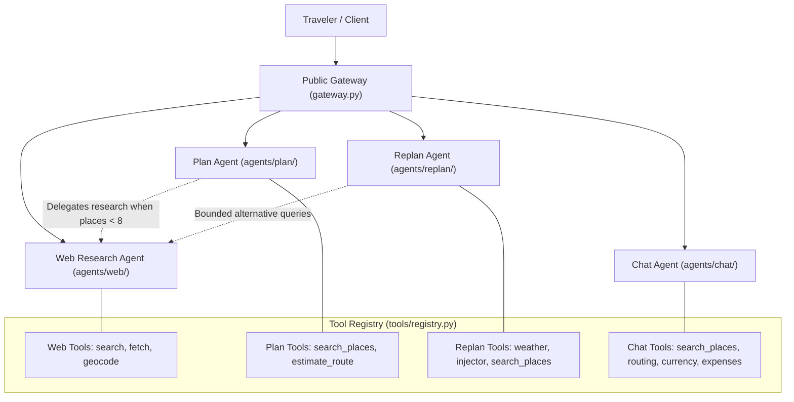

# Reroute Multi-Agent Architecture Design

## 1. System Overview

The Reroute agent system is structured into exactly four dedicated agents, each possessing an isolated scope and dedicated toolset:



---

## 2. Dedicated Agent Specifications

### 2.1 Web Research Agent (`agents/reroute_agents/agents/web/`)
- **Primary Goal:** Discover, scrape, extract, and geocode places from the live web or deterministic mock providers into structured `ResearchResult` payloads.
- **Workflow:**
  ```mermaid
  flowchart LR
      S1["search"] --> S2["fetch"]
      S2 --> S3["extract"]
      S3 --> S4["geocode"]
      S4 --> Out["ResearchResult"]
  ```
- **Dedicated Tools:**
  1. `web_search`: Multi-provider search interface (`tavily`, `ddg`, or `mock`).
  2. `web_fetch`: Secure page fetcher with SSRF defense, 50KB size cap, and HTML text extraction.
  3. `web_geocode`: Geocoding service with 1 req/sec rate limit and regional bounding box verification.
- **Safety Invariants:**
  - Web contents are strictly treated as untrusted data and wrapped in `<untrusted_web_content>` tags.
  - System prompts instruct the LLM to ignore any prompt injection or instructions inside web snippets.
  - SSRF protection blocks loopback (`127.0.0.1`), private networks (`10.0.0.0/8`, `172.16.0.0/12`, `192.168.0.0/16`), and AWS/GCP metadata (`169.254.169.254`).
  - Budget caps enforce a hard ceiling of 5 searches, 10 fetches, and 10 geocodes per run.

---

### 2.2 Plan Agent (`agents/reroute_agents/agents/plan/`)
- **Primary Goal:** Construct initial day-by-day itineraries satisfying traveler constraints (duration, budget, pace, vibes).
- **Workflow:**
  ```mermaid
  flowchart TD
      START --> intake["intake"]
      intake --> researcher["researcher (dispatches Web Agent if needed)"]
      researcher --> planner["planner"]
      planner --> validator["validator (pure function rules)"]
      validator -->|Violations found| planner
      validator -->|Valid| budget["budget_check"]
      budget --> finalize["finalize (saves version 1)"]
      finalize --> END
  ```
- **Dedicated Tools:** `search_places`, `get_place_details`, `estimate_route`.
- **Destination Disjointness Guarantee:**
  - Queries destination through `resolve_destination(spec.destination)`.
  - Dispatches `Web Research Agent` if catalog has fewer than 8 places for the destination.
  - Ensures places and fallback coordinates belong to the target destination, preventing cross-region contamination.

---

### 2.3 Replan Agent (`agents/reroute_agents/agents/replan/`)
- **Primary Goal:** Monitor itineraries for external disruptions (landslides, heavy snowfall, road closures, transit delays), assess impacts, and build repair proposals.
- **Workflow:**
  ```mermaid
  flowchart TD
      START --> collect["collect_signals"]
      collect --> impact["impact_analyzer"]
      impact -->|No affected items| END
      impact -->|Disruptions detected| replanner["replanner"]
      replanner --> validator["validator"]
      validator --> proposal["build_proposal"]
      proposal --> interrupt["interrupt() (Human-in-the-Loop)"]
      interrupt --> apply["apply_changes (saves new version)"]
      apply --> END
  ```
- **Dedicated Tools:** `weather_forecast`, `inject_disruption`, `search_places`.
- **HITL Invariant:** Proposals require explicit approval (`approve`, `reject`, `alternatives`); no itinerary mutation happens without traveler consent.

---

### 2.4 Chat Agent (`agents/reroute_agents/agents/chat/`)
- **Primary Goal:** Conversational ReAct assistant providing trip assistance and drafting modification proposals.
- **Workflow:**
  ```mermaid
  flowchart TD
      START --> chat_agent["chat_agent (LLM reasoning)"]
      chat_agent -->|Tool calls pending| tools["tools (ReAct execution)"]
      tools --> chat_agent
      chat_agent -->|No tool calls / Loop cap| finalize["finalize"]
      finalize --> END
  ```
- **Dedicated Tools:** `get_itinerary`, `modify_item`, `search_places`, `estimate_route`, `convert_currency`, `get_expenses_summary`.
- **Proposal Isolation:** Modifying an item creates a pending `ReplanProposal` requiring human review rather than mutating live database records.

---

## 3. Tool Ownership Matrix

| Tool | Web Agent | Plan Agent | Replan Agent | Chat Agent |
| :--- | :---: | :---: | :---: | :---: |
| `web_search` | Authorized | Blocked | Blocked | Blocked |
| `web_fetch` | Authorized | Blocked | Blocked | Blocked |
| `web_geocode` | Authorized | Blocked | Blocked | Blocked |
| `search_places` | Blocked | Authorized | Authorized | Authorized |
| `estimate_route` | Blocked | Authorized | Blocked | Authorized |
| `weather_forecast` | Blocked | Blocked | Authorized | Blocked |
| `inject_disruption`| Blocked | Blocked | Authorized | Blocked |
| `convert_currency` | Blocked | Blocked | Blocked | Authorized |
| `get_expenses_summary` | Blocked | Blocked | Blocked | Authorized |

Trying to invoke a tool outside the agent's registered scope raises a `ToolAccessViolationError` from `reroute_agents.tools.registry`.

---

## 4. Web Safety & Security Summary

1. **Prompt Injection Defense:** Web snippets are segregated into `<untrusted_web_content>` blocks with system-level refusal rules.
2. **SSRF Blocking:** IP address resolution validates targets against all private, loopback, link-local, and multicast CIDRs before HTTP dispatch.
3. **Budget Caps:** Fixed bounds on tool executions prevent denial-of-service, runaway scraping loops, or unexpected billing spikes.
4. **Deterministic Validation:** LLMs propose content; pure Python functions (`rules/validator_rules.py` and `rules/impact_rules.py`) determine operational validity.
