# Reroute Agent Design: Complete Flowcharts and Visual Architecture

This document provides a comprehensive visual and operational specification of the Reroute agentic system implemented in `agents/reroute_agents/`. Every diagram corresponds directly to the compiled LangGraph graphs and deterministic rule systems in the codebase.

---

## Universal Shape Legend

To ensure clarity on projectors, grayscale printouts, and light/dark displays, every diagram uses distinct geometric shapes, explicit structural labels, and consistent text prefixes:

| Shape | Mermaid Syntax | Meaning | Description |
|---|---|---|---|
| **Stadium (Pill)** | `([Name])` | Start / End State | Entry or exit boundary of a graph or pipeline |
| **Rectangle** | `[Name]` | Deterministic Code Node | Pure Python function without stochastic LLM calls |
| **Rounded Rectangle** | `(Name)` | Stochastic LLM Node | Invokes a Large Language Model (Gemini, Groq, Ollama) |
| **Hexagon** | `{{Name}}` | Tool Call Node | Interfaces with external or simulated APIs (Weather, Routing, Places) |
| **Diamond** | `{Name}` | Decision / Routing Edge | Conditional edge evaluating state to select the next path |
| **Parallelogram** | `[/Name/]` | Human-in-the-Loop Step | Terminal traveler approval/rejection boundary (`interrupt()`) |
| **Cylinder** | `[(Name)]` | Storage / Checkpoint | In-memory repository, database cache, or state checkpointer |

---

## Diagram 1: Master System Architecture View

### Caption
The Master System Architecture defines the external boundary and internal orchestration of the Reroute agent package. The public entry points in `gateway.py` receive requests from trigger sources (user trip generation, user-driven disruptions, conversational queries, and the background monitor). The gateway instantiates repositories and checkpointers, selects one of the three compiled LangGraph state graphs (`plan_graph`, `replan_graph`, or `chat_graph`), and streams strongly-typed `AgentEvent` objects out to the backend SSE router.

### How to read it
Follow the flow from the top trigger sources into the gateway, through the three graph pipelines, across the shared LLM and Tool layers, down to storage and the outbound SSE event stream. The dashed boundary on the bottom right represents the FastAPI backend boundary outside `agents/`.


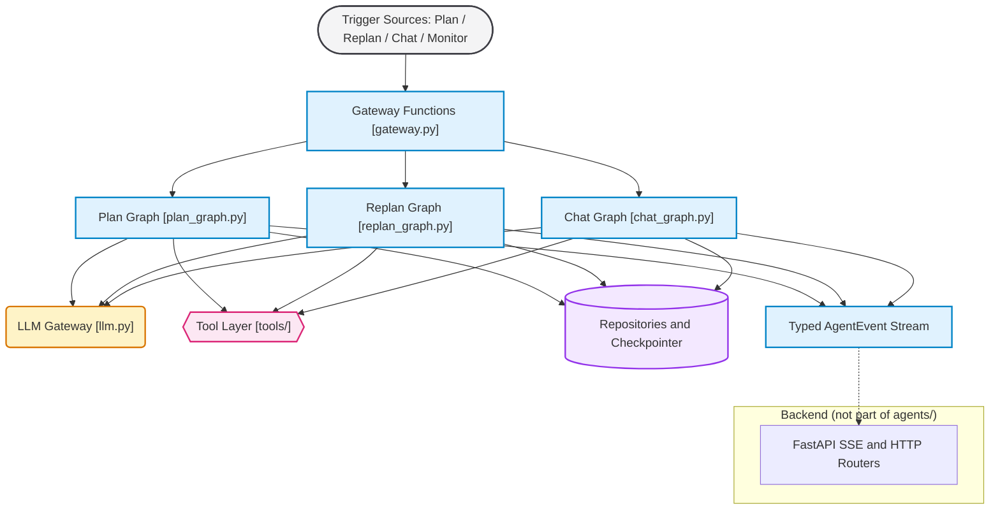

---

## Diagram 2: Plan Graph (Initial Itinerary Generation)

### Caption
The Plan Graph constructs, validates, and refines initial multi-day travel itineraries. The intake node validates the trip specification and registers the run. The researcher node queries the destination place catalog to retrieve relevant attractions matching user vibe tags. The planner node prompts the LLM to draft a day-by-day schedule. The validator node runs pure deterministic checks (opening hours, travel gaps, daily pace, altitude jumps, seasonal passes). If violations exist, the graph loops back to the planner (capped at `settings.max_plan_iterations = 3`). Once valid or capped, the budget check evaluates total and daily limits. The finalize node persists version 1 of the itinerary to the repository.

### How to read it
Trace the sequential pipeline from `START` to `validator_node`. Notice the conditional edge `route_after_validator`: if violations exist and the iteration counter is below 3, execution loops back to `planner_node`. If clean, it proceeds to `budget_check_node`. If the iteration cap (3) is reached with unresolved issues, it moves directly to `finalize_node` where unresolved violations are logged as non-blocking flags.


```mermaid
flowchart TD
  classDef stadium fill:#f4f4f5,stroke:#3f3f46,stroke-width:2px;
  classDef codeNode fill:#e0f2fe,stroke:#0284c7,stroke-width:2px;
  classDef llmNode fill:#fef3c7,stroke:#d97706,stroke-width:2px;
  classDef toolNode fill:#fce7f3,stroke:#db2777,stroke-width:2px;
  classDef decisionNode fill:#fef9c3,stroke:#ca8a04,stroke-width:2px;

  START([START]):::stadium --> INTAKE["Validate Trip Spec [intake_node]"]:::codeNode
  INTAKE --> RESEARCH{{"Search Catalog Places [researcher_node]"}}:::toolNode
  RESEARCH --> PLANNER("Draft Day-by-Day Itinerary [planner_node]"):::llmNode
  PLANNER --> VALIDATE["Execute Pure Rules [validator_node]"]:::codeNode

  VALIDATE --> COND_VAL{"Violations Exist? [route_after_validator]"}:::decisionNode
  COND_VAL -- "Issues and Iter less than 3" --> PLANNER
  COND_VAL -- "Issues and Iter at 3 (Cap)" --> FINALIZE["Persist Version and Flag Issues [finalize_node]"]:::codeNode
  COND_VAL -- "No Violations" --> BUDGET["Audit Cost and Daily Limits [budget_check_node]]:::codeNode

  BUDGET --> COND_BUD{"Budget OK? [route_after_budget]"}:::decisionNode
  COND_BUD -- "Overrun and Iter less than 3" --> PLANNER
  COND_BUD -- "Passed or Iter at 3" --> FINALIZE

  FINALIZE --> END_NODE([END: Initial Itinerary v1]):::stadium
```

---

## Diagram 3: Replan Graph (The Autonomous Replan Cycle)

### Caption
The Replan Graph executes the core autonomous resilience loop of Reroute. When triggered with live or injected signals, `collect_signals_node` queries weather and incurred expenses. `impact_analyzer_node` matches signals against current itinerary items using deterministic rules and computes a SHA-256 fingerprint. If no items are affected, the graph exits cleanly without spending LLM tokens. If affected items exist, `replanner_node` generates targeted replacements while strictly preserving locked and unaffected stops. The proposed plan passes through `validator_node`. `build_proposal_node` generates a structured diff and calls LangGraph's `interrupt()` to halt execution. The traveler reviews the proposal and selects `approve`, `reject`, or `alternatives`. When resumed, `apply_changes_node` increments the itinerary version on approval, discards changes on rejection, or loops back to the replanner on alternatives.

### How to read it
Start at `collect_signals_node`, follow through to the decision diamond `COND_IMP`. If disruptions exist, follow through the replanner and validator loop to `build_proposal_node`. Note the parallelogram `Traveler Decision`, which represents the human-in-the-loop interruption boundary. Resume branches into three outcomes based on `route_after_decision`.


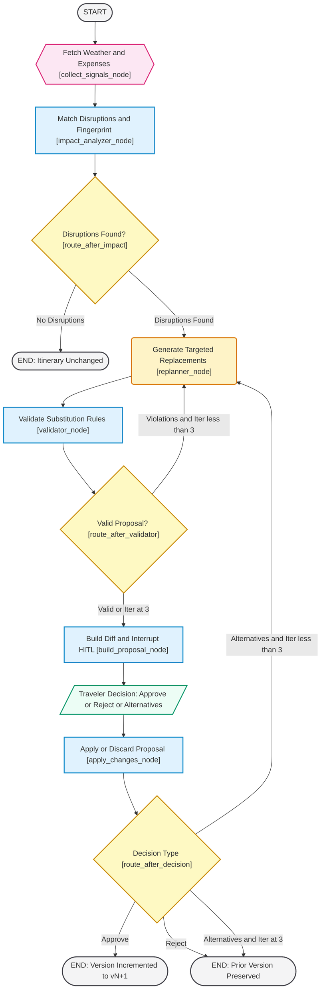

---

## Diagram 4: Chat Graph (Conversational Assistant and Safe Tools)

### Caption
The Chat Graph implements a ReAct-style conversational agent capable of querying place information, calculating travel times, and inspecting the current itinerary. If a user asks to modify an itinerary item (e.g., "swap afternoon tea for a hike"), the tool `modify_itinerary_item` does not perform a direct database write. Instead, it creates an unapplied `ReplanProposal`, preserving the strict human-in-the-loop invariant. The agent loop is capped at `settings.max_chat_iterations = 5` to prevent infinite tool-call recursion.

### How to read it
Begin at `START` entering `chat_agent_node`. The conditional edge checks if the LLM emitted tool calls. If yes, it routes to `tools_node` and loops back to `chat_agent_node` (up to 5 iterations). If no tool calls are needed or the iteration cap is reached, it routes to `finalize_node` which streams the final response tokens and terminates at `END`.


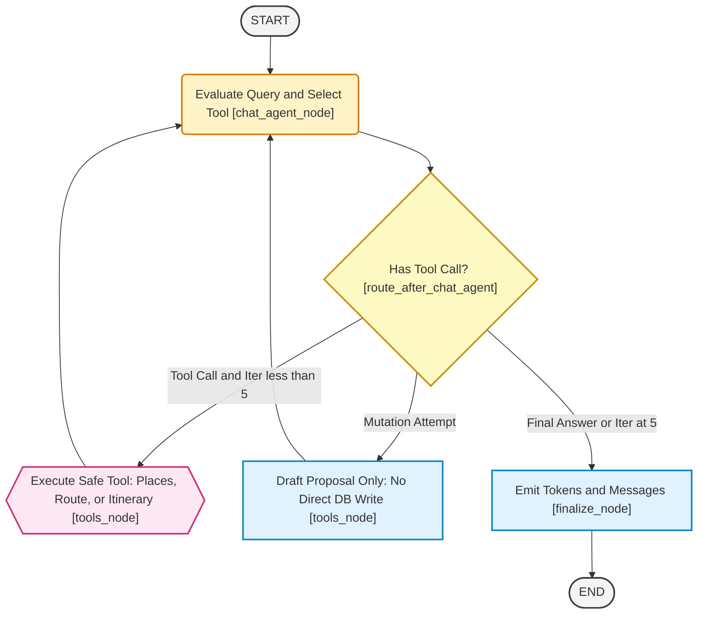

---

## Diagram 5: Human-in-the-Loop Sequence Diagram

### Caption
This sequence diagram captures the exact protocol governing human-in-the-loop (HITL) approval across the six participating subsystems: Traveler, Frontend UI, Backend API, Gateway (`gateway.py`), Replan Graph (`replan_graph.py`), and Checkpointer (`checkpointer.py`). When a proposal is generated, `interrupt()` freezes execution and commits graph state to storage using `thread_id = str(run_id)`. The stream terminates without applying changes. Only when the traveler submits an explicit decision does the backend invoke `resume_replan`, reloading the thread and applying changes.

### How to read it
Read chronologically from top to bottom. Notice steps 1-8 execute autonomously until `interrupt()` pauses the graph. Steps 9-16 illustrate the resumption cycle triggered by human action.


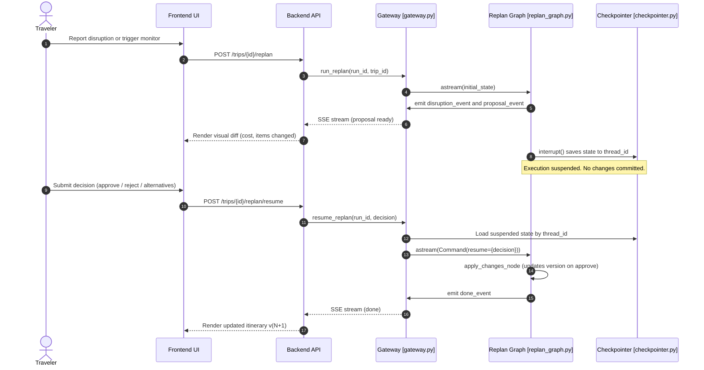

---

## Diagram 6: Event Stream Timeline

### Caption
The Event Stream Timeline maps the real, verified event emissions captured from offline test traces (`01_plan_run.json` and `02_replan_approve_run.json`). In planning, 18 events are emitted across intake, catalog research, planner iterations 1 to 3, validator checks, and finalization. In replanning, 12 events are emitted from signal collection and disruption detection to proposal creation, human interruption, resumption, and version increment.

### How to read it
Left box: Step-by-step emission order during initial planning. Right box: Step-by-step emission order during disruption replanning, highlighting where human interruption pauses the stream between events 9 and 10.


```mermaid
flowchart TD
  classDef stadium fill:#f4f4f5,stroke:#3f3f46,stroke-width:2px;
  classDef codeNode fill:#e0f2fe,stroke:#0284c7,stroke-width:2px;
  classDef llmNode fill:#fef3c7,stroke:#d97706,stroke-width:2px;
  classDef toolNode fill:#fce7f3,stroke:#db2777,stroke-width:2px;
  classDef humanNode fill:#ecfdf5,stroke:#059669,stroke-width:2px;

  subgraph PLAN_EVENTS ["Plan Stream: 18 Real Events"]
    P1["step: intake"]:::codeNode --> P2{{"tool_call and tool_result: researcher"}}:::toolNode
    P2 --> P3("step and draft: planner iter 1"):::llmNode
    P3 --> P4["step: validator 4 issues"]:::codeNode
    P4 --> P5("step and draft: planner iter 2"):::llmNode
    P5 --> P6["step: validator 4 issues"]:::codeNode
    P6 --> P7("step and draft: planner iter 3"):::llmNode
    P7 --> P8["step: validator cap reached"]:::codeNode
    P8 --> P9["step: finalize v1"]:::codeNode
    P9 --> P10([done: completed]):::stadium
  end

  subgraph REPLAN_EVENTS ["Replan Stream: 12 Real Events"]
    R1{{"step: collect_signals"}}:::toolNode --> R2["disruption: rain Day 2"]:::codeNode
    R2 --> R3("step: replanner substitution"):::llmNode
    R3 --> R4["step: validator passed"]:::codeNode
    R4 --> R5["proposal: ready for review"]:::codeNode
    R5 --> R6[/"PAUSE: interrupt HITL"/]:::humanNode
    R6 --> R7["step: resumed approve"]:::codeNode
    R7 --> R8["step: apply_changes updated v2"]:::codeNode
    R8 --> R9([done: completed]):::stadium
  end
```

---

## Diagram 7: LLM Gateway and Fallback Flow

### Caption
The LLM layer (`llm.py`) provides resilient, fault-tolerant model calls across tiered provider chains (Gemini Pro/Flash -> Groq Llama -> Ollama). Every call is rate-limited via an in-memory `TokenBucketRateLimiter` (default: 60 RPM, capacity 10). If a provider fails with a 429 or 5xx, the call retries with exponential backoff (max 2 retries). If all retries fail, it falls back to the next model in the chain. When structured output fails schema validation, `_invoke_with_repair` issues a single targeted repair prompt before falling back.

### How to read it
Start from `START` at the top. Follow through token bucket throttling to provider invocation. Note the retry loop on network failure, the fallback transition on provider exhaustion, and the 1-shot repair loop on structured JSON parsing error.


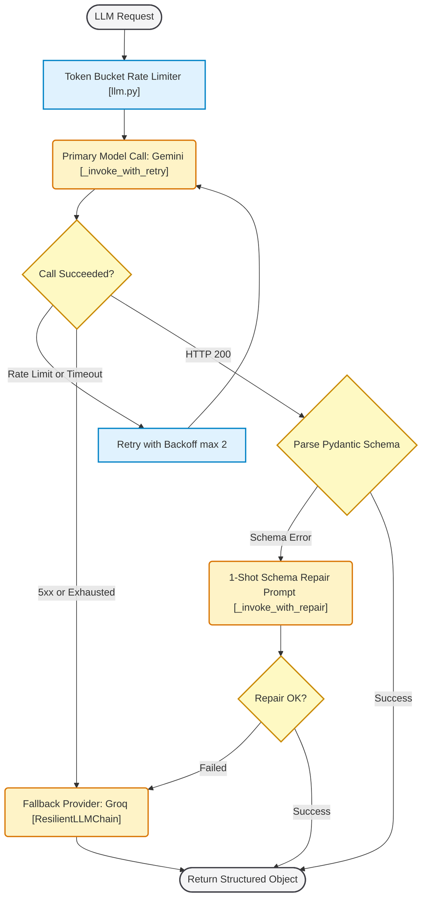

---

## Diagram 8: Tool Call Wrapper Flow

### Caption
All external tools (weather, routing, places, currency, expenses) are wrapped with the `@safe_tool` decorator (`tools/base.py`). The wrapper first checks `settings.mock_tools`; if enabled, it returns deterministic seed data immediately. In live mode, it checks the in-memory cache repository (`api_cache` key, TTL 3600s). On a cache miss, it checks whether an artificial disruption was injected. If not, it executes the async HTTP call with a 10-second timeout and 3-attempt tenacity retry. Uncaught exceptions are normalized into a clean dictionary `{"ok": False, "error": str(e)}` rather than crashing the agent graph.

### How to read it
Trace the priority order: Mock Mode -> Cache Hit -> Disruption Injector -> Async Network Call -> Exception Normalization.


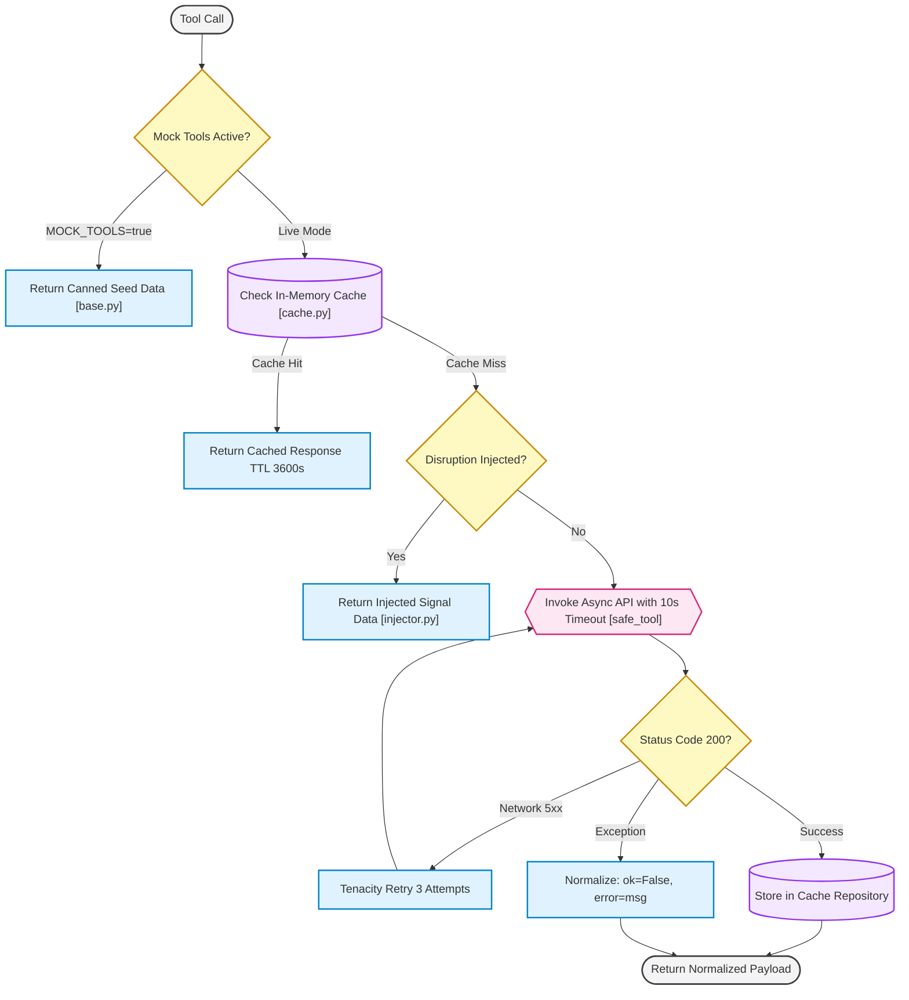

---

## Diagram 9: Validator Rules Decision Flow

### Caption
The deterministic itinerary validator (`rules/validator_rules.py`) enforces 9 strict constraint categories in sequence without calling an LLM. Rules check for schedule overlaps, 30-minute transit gaps, venue operating hours, total and daily budget ceilings, immutability of locked items, daily pace limits, altitude jump thresholds (>1200m elevation gain in a single day), seasonal pass closures, and required inner-line permits (ILP/PAP). Violations are aggregated into a list of typed `Violation` objects.

### How to read it
Follow the sequential evaluation pipeline from rule 1 to rule 9. If the final violations list is empty, the itinerary is marked valid; otherwise, the violation list is returned to the graph for iterative repair.


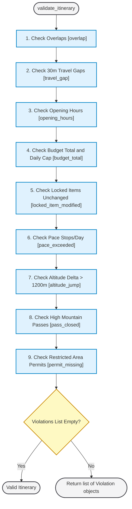

---

## Diagram 10: Impact Analyzer Decision Flow

### Caption
The Impact Analyzer (`rules/impact_rules.py`) ingests real-world weather, closure, transit, and expense signals and identifies affected itinerary stops using pure deterministic rules. Each detected disruption is assigned a deterministic SHA-256 fingerprint generated from trip ID, category, date, and impacted place. If a disruption with the same fingerprint is already active in the disruptions repository, it is deduplicated to prevent duplicate replan churn.

### How to read it
Follow signals entering from the left. Each rule independently filters for threshold violations (e.g., rain probability >= 70%, transit delay >= 30 mins). All matching disruptions generate a SHA-256 fingerprint, deduplicate against the database, and yield `DisruptionEvent` records.


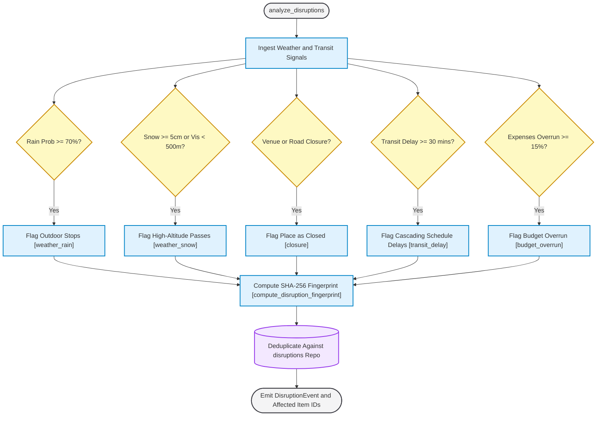

---

## Diagram 11: Monitor Flow (Zero-LLM Autonomous Sentry)

### Caption
The Monitor worker (`monitor.py`) periodically scans active trips to detect emerging disruptions. To operate economically at scale, `evaluate_trip` runs exclusively using cached weather/transit tools and deterministic impact rules. It expends zero LLM tokens during quiescent monitoring. Only when an unresolved disruption affecting scheduled stops is identified does the monitor persist the disruption record and trigger `gateway.run_replan`.

### How to read it
Observe the cycle from periodic activation to itinerary retrieval, lightweight tool queries, and deterministic rule execution. Note that the "No Impact" branch returns immediately with zero LLM expenditure.


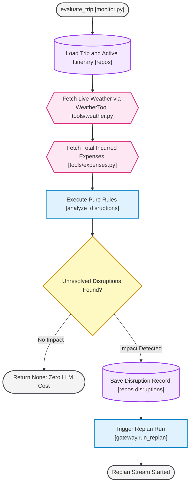

---

## Diagram 12: Data and State Model

### Caption
The Reroute state architecture couples Pydantic v2 data models with LangGraph `TypedDict` state containers (`state.py`). Pydantic models define domain entities (`TripSpec`, `DraftItem`, `Violation`, `DisruptionEvent`, `ReplanProposal`), while `PlanState` and `ReplanState` manage execution channels. Accumulating event logs use LangGraph's `Annotated[list[AgentEvent], operator.add]` reducer to provide streaming updates.

### How to read it
Left to right: Domain entities connect hierarchically to `DraftItem` and `ReplanProposal`. Bottom: `PlanState` and `ReplanState` aggregate domain models and append-only `AgentEvent` sequences.


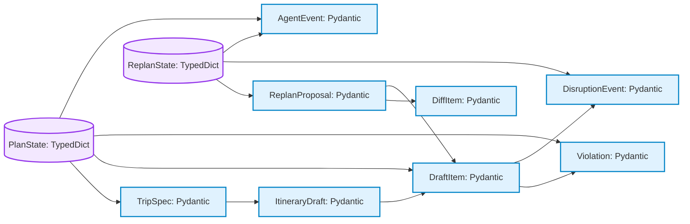

---

## Diagram 13: Module Dependency Map

### Caption
The module dependency map reflects the clean layered architectural hierarchy of `agents/reroute_agents/`. High-level routers (`api.py`, `gateway.py`, `monitor.py`) import graph definitions. Graphs compose nodes and tools. Nodes depend on deterministic rules and the resilient LLM chain. All lower layers depend on leaf schemas in `state.py`. There are zero circular imports across the package.

### How to read it
Top-to-bottom: Ingestion/API layer -> Gateway & Checkpointer -> Graph Orchestration -> Nodes & Tools -> Rules & LLM -> State & Events.


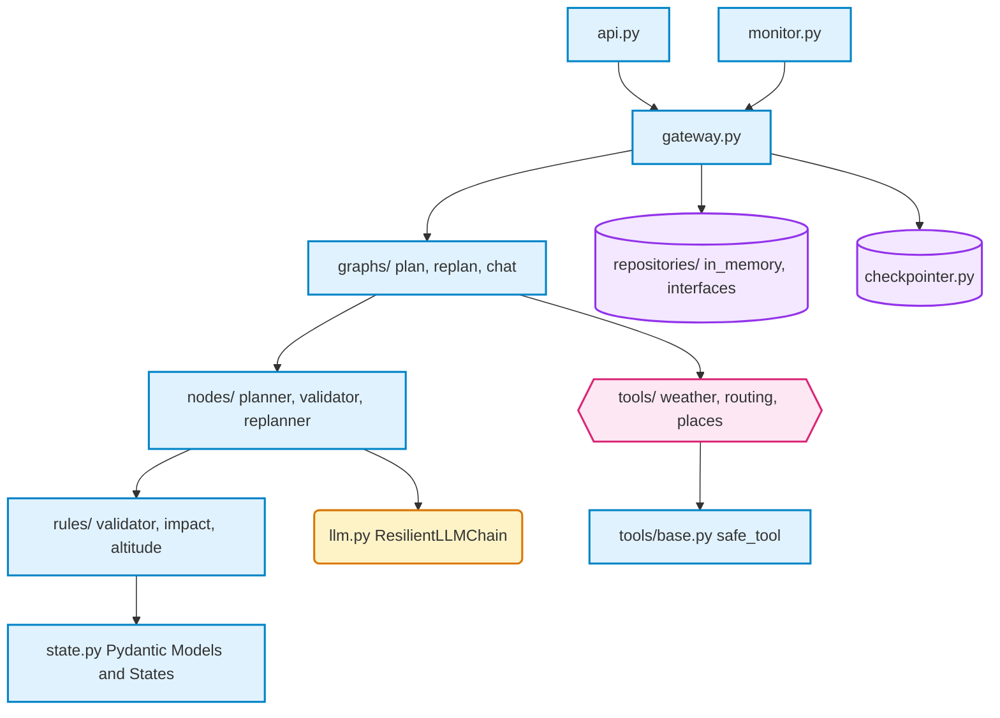

---

## Diagram 14: Simplified One-Slide Overview

### Caption
This high-level presentation slide summarizes the 7 stages of the Reroute agentic loop in plain English without technical code identifiers. It highlights the core design thesis: **External signals are sensed, deterministic code analyzes impact and verifies constraints, the LLM proposes substitutions, and the human traveler retains final decision authority.**

### How to read it
Read sequentially left to right from Step 1 (SENSE) to Step 7 (WATCH), with the feedback arrow showing continuous monitoring.


```mermaid
flowchart LR
  classDef toolNode fill:#fce7f3,stroke:#db2777,stroke-width:2px;
  classDef codeNode fill:#e0f2fe,stroke:#0284c7,stroke-width:2px;
  classDef llmNode fill:#fef3c7,stroke:#d97706,stroke-width:2px;
  classDef humanNode fill:#ecfdf5,stroke:#059669,stroke-width:2px;

  SENSE["1. SENSE<br/>Collect live weather, road closures, expenses"]:::toolNode --> ANALYZE["2. ANALYZE<br/>Map disruptions to stops via pure deterministic rules"]:::codeNode
  ANALYZE --> PROPOSE["3. PROPOSE<br/>Autonomous LLM generates minimal substitutions"]:::llmNode
  PROPOSE --> VERIFY["4. VERIFY<br/>Deterministic rules audit hours, gaps, pace, altitude"]:::codeNode
  VERIFY --> DECIDE[/"5. HUMAN DECISION<br/>Traveler Approves, Rejects, or Asks Alternatives"/]:::humanNode
  DECIDE --> ACT["6. ACT<br/>Land new itinerary version upon approval"]:::codeNode
  ACT --> WATCH["7. WATCH<br/>Background monitor checks signals with 0 LLM cost"]:::codeNode
  WATCH -.-> SENSE
```

---

## Diagram-to-Code Traceability Index

Every box and transition across all 14 diagrams maps directly to an exact function, class, and source file in the repository:

| Diagram | Node or Edge Label | File Path | Function or Class Name | Line Number |
|---|---|---|---|---|
| **01-master** | Gateway Functions | `agents/reroute_agents/gateway.py` | `run_plan`, `run_replan`, `run_chat` | L47, L142, L285 |
| **01-master** | Plan Graph | `agents/reroute_agents/graphs/plan_graph.py` | `build_plan_graph` | L47-L95 |
| **01-master** | Replan Graph | `agents/reroute_agents/graphs/replan_graph.py` | `build_replan_graph` | L48-L105 |
| **01-master** | Chat Graph | `agents/reroute_agents/graphs/chat_graph.py` | `build_chat_graph` | L387-L455 |
| **01-master** | LLM Gateway | `agents/reroute_agents/llm.py` | `get_llm` | L236-L257 |
| **01-master** | Tool Layer | `agents/reroute_agents/tools/base.py` | `safe_tool` | L24-L74 |
| **01-master** | Repositories & Checkpointer | `agents/reroute_agents/repositories/in_memory.py` | `create_in_memory_repositories` | L323-L347 |
| **02-plan-graph** | Validate Trip Spec [intake_node] | `agents/reroute_agents/nodes/intake.py` | `intake_node` | L14-L23 |
| **02-plan-graph** | Search Catalog Places [researcher_node] | `agents/reroute_agents/nodes/researcher.py` | `create_researcher_node` | L26-L62 |
| **02-plan-graph** | Draft Itinerary [planner_node] | `agents/reroute_agents/nodes/planner.py` | `create_planner_node` | L24-L190 |
| **02-plan-graph** | Execute Pure Rules [validator_node] | `agents/reroute_agents/nodes/validator.py` | `validator_node` | L14-L60 |
| **02-plan-graph** | Violations Exist? [route_after_validator] | `agents/reroute_agents/graphs/plan_graph.py` | `route_after_validator` | L21-L32 |
| **02-plan-graph** | Audit Cost & Daily Limits [budget_check_node] | `agents/reroute_agents/nodes/budget_check.py` | `budget_check_node` | L14-L58 |
| **02-plan-graph** | Budget OK? [route_after_budget] | `agents/reroute_agents/graphs/plan_graph.py` | `route_after_budget` | L34-L45 |
| **02-plan-graph** | Persist Version [finalize_node] | `agents/reroute_agents/nodes/finalize.py` | `create_finalize_node` | L22-L76 |
| **03-replan-graph** | Fetch Signals [collect_signals_node] | `agents/reroute_agents/nodes/collect_signals.py` | `create_collect_signals_node` | L15-L46 |
| **03-replan-graph** | Match Disruptions [impact_analyzer_node] | `agents/reroute_agents/nodes/impact_analyzer.py` | `create_impact_analyzer_node` | L17-L70 |
| **03-replan-graph** | Disruptions Found? [route_after_impact] | `agents/reroute_agents/graphs/replan_graph.py` | `route_after_impact` | L21-L28 |
| **03-replan-graph** | Generate Replacements [replanner_node] | `agents/reroute_agents/nodes/replanner.py` | `create_replanner_node` | L22-L161 |
| **03-replan-graph** | Build Diff & Interrupt [build_proposal_node] | `agents/reroute_agents/nodes/build_proposal.py` | `create_build_proposal_node` | L18-L173 (interrupt at L94) |
| **03-replan-graph** | Apply or Discard [apply_changes_node] | `agents/reroute_agents/nodes/apply_changes.py` | `create_apply_changes_node` | L18-L112 |
| **03-replan-graph** | Decision Type [route_after_decision] | `agents/reroute_agents/graphs/replan_graph.py` | `route_after_decision` | L38-L46 |
| **04-chat-graph** | Select Tool [chat_agent_node] | `agents/reroute_agents/graphs/chat_graph.py` | `chat_agent_node` | L123-L215 |
| **04-chat-graph** | Execute Safe Tool [tools_node] | `agents/reroute_agents/graphs/chat_graph.py` | `tools_node` | L293-L373 |
| **04-chat-graph** | Modify Stop (Proposal Only) | `agents/reroute_agents/graphs/chat_graph.py` | `modify_itinerary_item` | L252-L291 |
| **04-chat-graph** | Emit Tokens & Messages [finalize_node] | `agents/reroute_agents/graphs/chat_graph.py` | `finalize_node` | L375-L385 |
| **05-hitl-sequence** | run_replan initiation | `agents/reroute_agents/gateway.py` | `run_replan` | L142-L248 |
| **05-hitl-sequence** | interrupt() checkpoint save | `agents/reroute_agents/nodes/build_proposal.py` | `create_build_proposal_node` | L94 |
| **05-hitl-sequence** | resume_replan resumption | `agents/reroute_agents/gateway.py` | `resume_replan` | L252-L283 |
| **05-hitl-sequence** | Command(resume={...}) | `agents/reroute_agents/gateway.py` | `resume_replan` | L261 |
| **06-event-timeline** | Typed AgentEvent Factory | `agents/reroute_agents/events.py` | `step_event`, `proposal_event`, etc. | L23-L172 |
| **07-llm-fallback** | Token Bucket Limiter | `agents/reroute_agents/llm.py` | `TokenBucketRateLimiter` | L28-L59 |
| **07-llm-fallback** | Resilient Chain & Retry | `agents/reroute_agents/llm.py` | `ResilientLLMChain._invoke_with_retry` | L107-L149 |
| **07-llm-fallback** | 1-Shot Schema Repair | `agents/reroute_agents/llm.py` | `ResilientLLMChain._invoke_with_repair` | L151-L188 |
| **08-tool-wrapper** | safe_tool Decorator | `agents/reroute_agents/tools/base.py` | `safe_tool` | L24-L74 |
| **08-tool-wrapper** | Disruption Injector | `agents/reroute_agents/tools/injector.py` | `inject_disruption` | L17-L77 |
| **09-validator-rules** | Pure Itinerary Validator | `agents/reroute_agents/rules/validator_rules.py` | `validate_itinerary` | L18-L162 |
| **09-validator-rules** | Altitude Jump Rule | `agents/reroute_agents/rules/altitude.py` | `check_altitude_and_acclimatization` | L16-L132 |
| **09-validator-rules** | Mountain Pass Closure Rule | `agents/reroute_agents/rules/seasonal.py` | `check_seasonal_access` | L14-L81 |
| **09-validator-rules** | Permit Verification Rule | `agents/reroute_agents/rules/permits.py` | `check_permits` | L14-L69 |
| **10-impact-rules** | Disruption Impact Analysis | `agents/reroute_agents/rules/impact_rules.py` | `analyze_disruptions` | L18-L230 |
| **10-impact-rules** | SHA-256 Disruption Fingerprint | `agents/reroute_agents/rules/impact_rules.py` | `compute_disruption_fingerprint` | L233-L255 |
| **11-monitor-flow** | Periodic Trip Evaluation | `agents/reroute_agents/monitor.py` | `evaluate_trip` | L23-L88 |
| **12-data-model** | Trip & Item Domain Schemas | `agents/reroute_agents/state.py` | `TripSpec`, `DraftItem`, `Violation` | L17-L107 |
| **12-data-model** | Proposal & Diff Schemas | `agents/reroute_agents/state.py` | `ReplanProposal`, `DiffItem` | L133-L177 |
| **12-data-model** | Graph State Schemas | `agents/reroute_agents/state.py` | `PlanState`, `ReplanState`, `ChatState` | L180-L208 |
| **13-module-dependencies** | Public FastAPI Router Boundary | `agents/reroute_agents/api.py` | `app` | L30-L200 |
