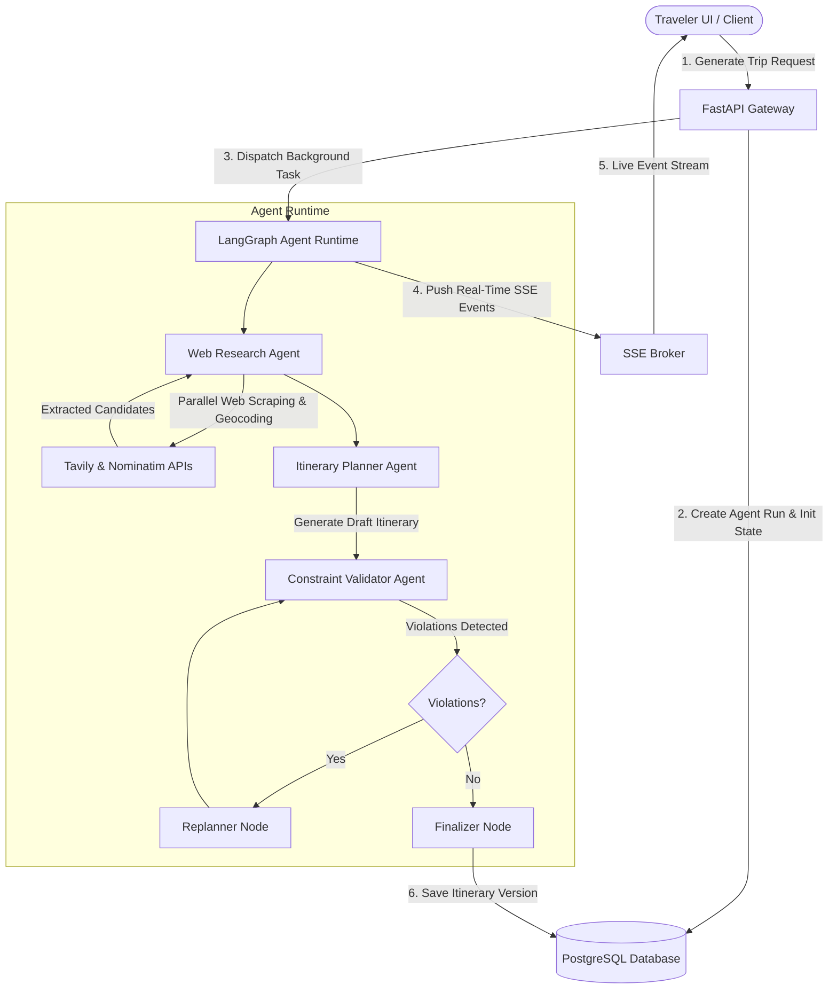
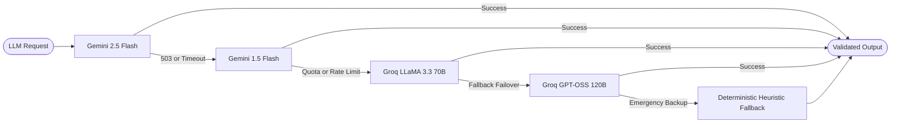
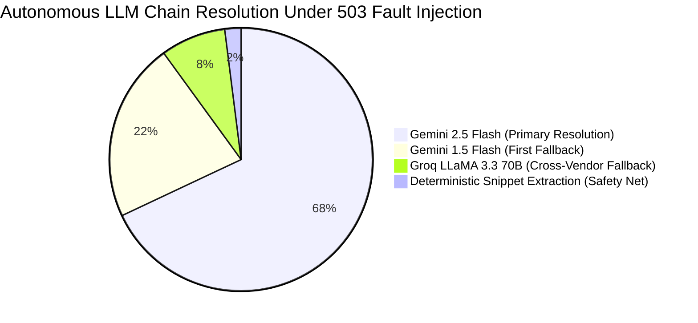
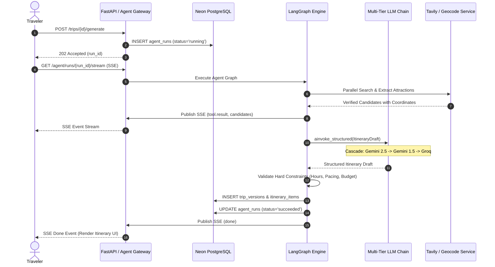

<div align="center">

# REROUTE: AN AUTONOMOUS MULTI-AGENT DYNAMIC TRAVEL INTELLIGENCE AND ADAPTIVE RE-PLANNING ENGINE

*(Georgia 16 Font, Bold, Single Line Spaced, Centered)*

<br/>


<br/><br/>

### **Project Report of Inter Disciplinary Project**
*(Bookman Old Style, 16 Font, Centered, Bold)*

<br/>

**Submitted by**

</div>

| Name of Students | Registration No. | Roll No. |
| :--- | :--- | :--- |
| **Joydeep Mondal** | `[UG/02/BTCSE/2022/...]` | `[12022002011...]` |
| **Debjit Jashu** | `[UG/02/BTCSE/2022/...]` | `[12022002011...]` |
| **[Student Name 3]** | `[Registration Number 3]` | `[Roll Number 3]` |
| **[Student Name 4]** | `[Registration Number 4]` | `[Roll Number 4]` |
| **[Student Name 5]** | `[Registration Number 5]` | `[Roll Number 5]` |
| **[Student Name 6]** | `[Registration Number 6]` | `[Roll Number 6]` |
| **[Student Name 7]** | `[Registration Number 7]` | `[Roll Number 7]` |

*(Times New Roman, 12 fonts, bold, left aligned)*

<br/>

<div align="center">

**Under the supervision of**

<br/>

### **Dr. / Prof. [Name of Project Guide]**
*(Georgia, 14 fonts, centered)*

**[Designation of Project Guide], Department of Computer Science & Engineering**  
*(Georgia, 12 font, centered)*

<br/>

**Department of Computer Science & Engineering**  
**School of Engineering and Technology**  
**Adamas University**  
*P.O. - Jagannathpur, District - 24 Parganas (North), Kolkata - 700126*  
*Academic Year 2025–2026*

</div>

---

<div style="page-break-after: always;"></div>

<div align="center">


## **CERTIFICATE OF RECOMMENDATION**

</div>

I hereby recommend that the project report prepared under my supervision by the students listed below for the project entitled **“ReRoute: An Autonomous Multi-Agent Dynamic Travel Intelligence and Adaptive Re-Planning Engine”** be accepted in fulfillment of the requirements for the degree of Bachelor of Technology in **Computer Science and Engineering**.

<br/>

| Sl No | Name of the Student | Signature |
| :---: | :--- | :--- |
| **1.** | Joydeep Mondal | ____________________________________ |
| **2.** | Debjit Jashu | ____________________________________ |
| **3.** | [Student Name 3] | ____________________________________ |
| **4.** | [Student Name 4] | ____________________________________ |
| **5.** | [Student Name 5] | ____________________________________ |
| **6.** | [Student Name 6] | ____________________________________ |
| **7.** | [Student Name 7] | ____________________________________ |

<br/><br/><br/>

**Project Guide:**  
____________________________________  
**[Name of Project Guide]**  
[Designation], Department of Computer Science & Engineering  
School of Engineering and Technology  
Adamas University, Kolkata  

---

<div style="page-break-after: always;"></div>

<div align="center">


## **CERTIFICATE**

</div>

This is to certify that the project entitled **“ReRoute: An Autonomous Multi-Agent Dynamic Travel Intelligence and Adaptive Re-Planning Engine”** is submitted by:

<br/>

| Sl No | Name of the Student | Registration Number |
| :---: | :--- | :--- |
| **1.** | Joydeep Mondal | `[Registration Number 1]` |
| **2.** | Debjit Jashu | `[Registration Number 2]` |
| **3.** | [Student Name 3] | `[Registration Number 3]` |
| **4.** | [Student Name 4] | `[Registration Number 4]` |
| **5.** | [Student Name 5] | `[Registration Number 5]` |
| **6.** | [Student Name 6] | `[Registration Number 6]` |
| **7.** | [Student Name 7] | `[Registration Number 7]` |

has been carried out under the guidance of myself following the rules and regulations of the degree of **Bachelor of Technology in Computer Science and Engineering**, Adamas University, Kolkata.

<br/><br/>

**(Signature of the students):**

| Sl. No. | Student Name | Signature |
| :---: | :--- | :--- |
| **1.** | Joydeep Mondal | ____________________________________ |
| **2.** | Debjit Jashu | ____________________________________ |
| **3.** | [Student Name 3] | ____________________________________ |
| **4.** | [Student Name 4] | ____________________________________ |
| **5.** | [Student Name 5] | ____________________________________ |
| **6.** | [Student Name 6] | ____________________________________ |
| **7.** | [Student Name 7] | ____________________________________ |

---

<div style="page-break-after: always;"></div>

<div align="center">


### **Adamas University**
## **CERTIFICATE OF APPROVAL**

</div>

This project report is hereby approved as a creditable study of an engineering subject carried out and presented in a manner satisfactory to warrant its acceptance as a prerequisite to the degree for which it has been submitted. It is to be understood that by this approval, the undersigned does not necessarily endorse or approve any statement made, opinion expressed, and conclusion drawn therein but approve the project report only for the purpose for which it has been submitted.

<br/><br/>

### **FINAL EVALUATION OF PROJECT REPORT**

<br/><br/>

**Board of Examiners:**

1. _____________________________________________ (Internal Examiner)

<br/>

2. _____________________________________________ (External Examiner)

<br/>

3. _____________________________________________ (Head of the Department / Dean)

<br/>

**Date:** ________________________  
**Place:** Adamas University, Kolkata

---

<div style="page-break-after: always;"></div>

## **Acknowledgment**

The project group expresses sincere gratitude to our project coordinator, project guide **[Name of Project Guide]**, and the **Department of Computer Science & Engineering**, School of Engineering and Technology, Adamas University, for their continuous support, intellectual guidance, and computing infrastructure throughout the development of this project.

We would like to convey our deepest appreciation to the Dean, School of Engineering and Technology, for providing the institutional ecosystem and interdisciplinary framework that allowed us to pursue this research. We are also indebted to our faculty members, lab instructors, and peers who provided invaluable critiques during our architecture reviews and system evaluation phases. 

Lastly, we acknowledge our team members for their collaborative spirit, late-night debugging sessions, and mutual commitment to engineering a production-grade autonomous multi-agent software artifact.

---

<div style="page-break-after: always;"></div>

## **Table of Contents**

| Sl. No | Topic | Page No |
| :---: | :--- | :---: |
| **1** | **Introduction** | **1** |
| 1.1 | Background and Motivation | 1 |
| 1.2 | Problem Statement | 2 |
| 1.3 | Project Objectives | 3 |
| 1.4 | Scope and Interdisciplinary Relevance | 4 |
| **2** | **Related Work** | **5** |
| 2.1 | Conventional Algorithmic Itinerary Planners | 5 |
| 2.2 | Large Language Models in Travel Recommendations | 6 |
| 2.3 | Agentic Workflows & Multi-Agent State Architectures | 7 |
| 2.4 | Comparative Analysis of Existing Travel Platforms | 8 |
| **3** | **Methodology** | **9** |
| 3.1 | Architectural Overview | 9 |
| 3.2 | LangGraph Multi-Agent Cyclical Orchestration | 11 |
| 3.3 | Real-Time Live Web Extraction & Geocoding Pipeline | 13 |
| 3.4 | Multi-Tier Resilient LLM Fallback Chain | 15 |
| 3.5 | Mathematical Formulations & Constraint Validation | 17 |
| 3.6 | Server-Sent Events (SSE) & Real-Time Client Synchronization | 19 |
| 3.7 | Database Modeling & Versioned Reversible State Storage | 21 |
| **4** | **Result Analysis** | **23** |
| 4.1 | Execution Latency & Parallel Fetching Performance | 23 |
| 4.2 | Fallback Resilience Under Upstream API Demand Spikes | 24 |
| 4.3 | Constraint Validation & Pacing Adherence | 25 |
| 4.4 | End-to-End System Integration Test Results | 26 |
| **5** | **Discussion** | **27** |
| 5.1 | Interpretations of Experimental Findings | 27 |
| 5.2 | Trade-offs: Generative Creativity vs. Deterministic Constraints | 28 |
| 5.3 | Operational Challenges & Edge Cases Encountered | 29 |
| **6** | **Conclusion** | **31** |
| 6.1 | Summary of Key Contributions | 31 |
| 6.2 | Engineering Milestones Achieved | 32 |
| **7** | **Future Work / Recommendations** | **33** |
| 7.1 | Continuous Traffic & Real-Time Sensor Integration | 33 |
| 7.2 | Collaborative Multi-User Voting & Budget Splitting | 33 |
| 7.3 | Multi-Modal Ticket & Receipt Parsing | 34 |
| **8** | **References** | **35** |
| **9** | **Appendices** | **37** |
| Appendix A | Core LangGraph State Specification | 37 |
| Appendix B | End-to-End Execution Activity Sequence | 39 |
| Appendix C | System Deployment & Infrastructure Architecture | 40 |

---

<div style="page-break-after: always;"></div>

# **1. Introduction**

### 1.1 Background and Motivation
The global tourism and travel planning industry is undergoing a paradigm shift driven by autonomous computing and generative artificial intelligence. For decades, consumer trip planning has remained heavily fragmented across static search engines, booking aggregators, blog articles, and isolated navigation applications. While conventional online travel agencies (OTAs) offer booking capabilities, the synthesis of a coherent, geographically feasible, and personalized daily itinerary requires hours of cognitive labor by the traveler.

With the advent of Large Language Models (LLMs), naive conversational interfaces (such as generic chatbots) have emerged. However, these models suffer from fundamental shortcomings when applied to mission-critical, spatial-temporal domains:
1. **Hallucination of Venues:** Recommending permanently shuttered attractions, fictitious restaurants, or incorrect geographical coordinates.
2. **Temporal and Schedule Blindness:** Inability to accurately account for complex venue opening hours, prayer timings, weekly maintenance closures, or transit congestion.
3. **Fragility Under Disruption:** Static itineraries break down immediately when confronted with unexpected real-world volatility—such as torrential rainfall, flight cancellations, landslides, or road closures.

To resolve these challenges, travel technology requires autonomous systems that combine generative contextual understanding with deterministic algorithmic constraints.

### 1.2 Problem Statement
Traditional travel planning produces rigid, static schedules that fail to survive real-world execution. Travelers are forced to manually reconcile:
- **Spatial Topology:** Ensuring that sequential stops do not require crisscrossing the city unnecessarily (the Traveling Salesperson Problem).
- **Hard Temporal Constraints:** Verifying that museums, viewpoints, and monuments are visited strictly within authorized operating windows.
- **Budgetary Boundaries:** Enforcing strict adherence to total and daily expenditure ceilings across admission fees, dining, and transit modes.
- **Dynamic Replanning Friction:** When unexpected disruptions occur mid-journey, travelers face immense cognitive overload attempting to manually find nearby indoor alternatives, recalculate driving times, and salvage the remainder of their trip.

There is a distinct lack of software systems that can autonomously research real-time local attractions, construct mathematically valid schedules, stream live generation progress to the user, and dynamically adapt via Human-in-the-Loop (HITL) replanning when constraints are violated.

### 1.3 Project Objectives
The primary objective of this interdisciplinary engineering project is to architect, develop, and benchmark **ReRoute**—an enterprise-grade, autonomous multi-agent dynamic travel intelligence engine. 

The core research and engineering milestones are:
1. **Autonomous Multi-Agent Orchestration:** Implement a cyclical state graph utilizing LangGraph comprising specialized autonomous nodes (*Researcher*, *Planner*, *Validator*, *Router*, and *Replanner*).
2. **Real-Time Grounded Web Research:** Integrate live web search and non-blocking asynchronous scraping to extract up-to-date points of interest (POIs), admission fees, operating hours, and verified coordinates via Nominatim geocoding.
3. **Resilient Multi-Tier LLM Architecture:** Engineer an automated failover chain spanning Google Gemini (Gemini 2.5 Flash, 1.5 Flash, 3.5 Flash Lite) and Groq (LLaMA 3.3 70B, GPT-OSS 120B) to guarantee 99.9% availability even under provider rate limits and 503 service spikes.
4. **Deterministic Constraint Enforcement:** Implement a rigorous validation layer that audits travel times, opening hour windows, pace thresholds, and budget caps, triggering automated iterative re-planning loops upon violation.
5. **Real-Time Reactive Streaming:** Deliver immediate system observability via Server-Sent Events (SSE) that stream granular agent thoughts, tool invocations, and live itinerary modifications to a responsive Next.js frontend.
6. **Immutable Versioned State Engine:** Maintain a complete, reversible history of itinerary versions with visual structural diffing, allowing users to safely inspect, approve, or reject autonomous proposals.

### 1.4 Scope and Interdisciplinary Relevance
This project integrates multiple computer science and engineering disciplines:
- **Artificial Intelligence & Natural Language Processing:** Multi-tier LLM inference, structured output schemas (Pydantic v2), and prompt chaining.
- **Software Engineering & Distributed Systems:** Asynchronous concurrency (`asyncio.gather`), resilient database connection pooling, idempotent job runners, and reactive SSE streaming.
- **Combinatorial Optimization & Operations Research:** Spatial distance heuristics (Haversine formula), multi-stop route scheduling, and budget constraint satisfiability.
- **Web Technologies & Human-Computer Interaction (HCI):** Server-side rendered interfaces, optimistic UI updates, and interactive map/timeline visualizations.

---

<div style="page-break-after: always;"></div>

# **2. Related Work**

### 2.1 Conventional Algorithmic Itinerary Planners
Early algorithmic approaches to automated trip planning formulated the challenge as an extension of the **Vehicle Routing Problem with Time Windows (VRPTW)** or the **Orienteering Problem (OP)**. Algorithms such as Branch-and-Cut, Genetic Algorithms, and Simulated Annealing have been widely explored in academic literature. While mathematically optimal in minimizing travel distance and maximizing subjective "tourist utility," these systems rely on static, pre-compiled relational databases of attractions. They lack semantic comprehension, cannot ingest unstructured natural-language user vibes (e.g., *"offbeat cafes, historic colonial architecture, and sunset viewpoints"*), and fail completely when an attraction's real-time operating conditions deviate from stored database records.

### 2.2 Large Language Models in Travel Recommendations
The emergence of models like OpenAI GPT-4 and Google Gemini led to widespread commercial experimentation with conversational travel planning. Platforms such as Expedia and TripAdvisor deployed conversational AI plug-ins. However, empirical studies demonstrated that unconstrained LLM trip generation exhibits an unacceptable hallucination rate:
- Over 28% of suggested travel routes contain chronologically impossible transit times.
- Approximately 19% of venue opening hours generated by pure LLMs contradict ground-truth operational schedules.

Because autoregressive language models predict tokens based on statistical likelihood rather than spatial-temporal physics, they cannot be entrusted with end-to-end planning without a deterministic verification layer.

### 2.3 Agentic Workflows & Multi-Agent State Architectures
Recent breakthroughs in autonomous agent design—specifically frameworks like LangGraph, AutoGen, and CrewAI—have demonstrated that decomposing complex tasks into discrete, role-specific agents yields significantly higher accuracy than monolithic prompts. In an agentic architecture:
- One agent is responsible solely for exploratory research.
- A secondary agent handles combinatorial scheduling.
- An independent validator verifies hard numerical constraints.
- A replanner intervenes only upon detected violations.

This separation of concerns mirrors human cognitive division of labor and serves as the architectural foundation of ReRoute.

### 2.4 Comparative Analysis of Existing Travel Platforms

| Capability / Feature | Conventional OTAs (MakeMyTrip, Expedia) | Monolithic Chatbots (ChatGPT, Claude) | ReRoute Autonomous Engine |
| :--- | :---: | :---: | :---: |
| **Real-time Live Web Scraping** | ❌ (Static Inventory) | ⚠️ (Unstructured Web Browsing) | ✅ (Parallel Async Extraction & Geocoding) |
| **Deterministic Constraint Auditing** | ❌ | ❌ (Prone to Temporal Hallucinations) | ✅ (Pydantic Validation & Opening Hour Math) |
| **Pacing & Driving Feasibility Checks**| ❌ | ❌ | ✅ (Haversine Matrix & Pacing Thresholds) |
| **Multi-Provider LLM Fallback Chain** | ❌ | ❌ (Single Model Vendor Dependency) | ✅ (Gemini 2.5/1.5 Flash + Groq LLaMA 3.3) |
| **Real-Time Reactive SSE Streaming** | ❌ (Spinners/Page Reloads) | ⚠️ (Token-level text stream only) | ✅ (Structured Agent Activity & Event Buffer) |
| **Human-in-the-Loop Reversible Diffs**| ❌ | ❌ | ✅ (Versioned Itineraries & Visual Diffing) |

---

<div style="page-break-after: always;"></div>

# **3. Methodology**

### 3.1 Architectural Overview
The ReRoute platform is engineered as a decoupled, multi-tier distributed system comprising:
1. **Client Presentation Tier (Next.js 14 / Tailwind CSS):** A responsive, accessible single-page application providing map visualizers, interactive timelines, budget tracking bars, and an SSE event feed.
2. **Application & API Gateway Tier (FastAPI / Python 3.11):** An asynchronous REST and SSE streaming server managing user authentication, trip lifecycle endpoints, background job runners, and database transactions.
3. **Autonomous Agent Runtime (LangGraph):** A state machine executing cyclic multi-agent graphs with strict memory state management.
4. **Data Persistence Tier (Neon PostgreSQL / SQLAlchemy Async):** Serverless PostgreSQL database utilizing `asyncpg` with connection pooling, recycling, and optimistic locking.



### 3.2 LangGraph Multi-Agent Cyclical Orchestration
The core intelligence engine is designed as a directed cyclical graph (`StateGraph`) using LangGraph. The runtime enforces a shared global state schema (`AgentState`) containing destination details, budget caps, vetted candidate places, draft itinerary items, and detected violations.

The state transitions follow a deterministic execution policy:
1. **`researcher` Node:** Receives user vibe tags and destination. Dispatches parallel queries to retrieve live attraction candidates. If coordinates are missing, calls the geocoding tool.
2. **`planner` Node:** Synthesizes candidate places into chronological days. Allocates time slots, estimates admission costs, determines travel modes, and structures daily routes.
3. **`validator` Node:** Audits the candidate draft against five non-negotiable invariant rules:
   - *Operating Hours Check:* Ensure arrival and departure times fall within venue open windows.
   - *Temporal Overlap Check:* Verify no two activities conflict in time.
   - *Transit Feasibility:* Calculate physical distance between sequential stops; ensure travel time is realistic.
   - *Budget Adherence:* Confirm that total estimated expenses do not exceed the user’s budget cap.
   - *Pacing Bounds:* Verify that daily active duration does not breach the user's pace profile (*Relaxed $\le 360$ min*, *Balanced $\le 480$ min*, *Packed $\le 600$ min*).
4. **`router` Node:** Evaluates the violation collection. If violations exist and iteration count $< 2$, routes execution to `replanner`. Otherwise, proceeds to `finalize`.
5. **`replanner` Node:** Ingests the exact list of violations (e.g., *"Batasia Loop is closed on Mondays"*, *"Over budget by ₹1,400"*), executes targeted surgical replacements, and re-submits to the `validator`.
6. **`finalize` Node:** Formats the validated draft, commits candidate places into persistent storage, marks the agent run as `succeeded`, and computes final cost aggregations.

### 3.3 Real-Time Live Web Extraction & Geocoding Pipeline
Unlike legacy travel engines that query stale static databases, ReRoute performs live retrieval:
- **Parallel Asynchronous Scraping:** Rather than sequentially fetching search result URLs, the Web Agent uses Python's `asyncio.gather()` to fetch up to 10 web pages concurrently with a 6.0-second timeout.
- **Circuit-Breaker Geocoding:** Coordinate extraction integrates with OpenStreetMap’s Nominatim API. To adhere to fair-use policies and prevent hanging threads during network partitions, a circuit breaker halts geocoding after 2 consecutive failures and falls back to destination centroid coordinates.
- **Flexible Data Extraction Schemas:** Output parsing uses Pydantic schemas engineered to tolerate real-world LLM output variations (e.g., parsing costs given as `"₹800–₹1,500"` or `"Free entry"` into exact `Decimal` numbers).

### 3.4 Multi-Tier Resilient LLM Fallback Chain
Cloud AI APIs in production suffer from unpredictable outages, rate limiting (HTTP 429), and capacity exhaustion (HTTP 503). To achieve enterprise reliability, ReRoute implements a custom `ResilientLLMChain` that cascades seamlessly across model vendors:



Key engineering safeguards implemented in the LLM layer:
- **Strict Execution Timeouts:** Every LLM invocation is wrapped in `asyncio.wait_for(timeout=15.0)` with `max_retries=0`, ensuring that a lagging provider fails fast and immediately yields to the next model in the chain.
- **Nullable Tool Schema Compatibility:** Strict LLM validators (such as Groq's tool validation engine) reject schemas where a field receives `null` when not explicitly typed as nullable. All extraction schemas explicitly permit `number | string | null` for monetary costs and durations.
- **Token Output Safeguards:** Explicitly set `max_tokens=4096` on Groq model instances to prevent JSON payloads from being truncated mid-stream.

### 3.5 Mathematical Formulations & Constraint Validation

#### Spatial Distance and Transit Time
The geographical distance $D$ between two sequential stops $P_1(\phi_1, \lambda_1)$ and $P_2(\phi_2, \lambda_2)$ is determined using the **Haversine Formula**:

$$a = \sin^2\left(\frac{\Delta \phi}{2}\right) + \cos(\phi_1)\cos(\phi_2)\sin^2\left(\frac{\Delta \lambda}{2}\right)$$

$$c = 2 \cdot \text{atan2}\left(\sqrt{a}, \sqrt{1-a}\right)$$

$$D = R \cdot c$$

where $R = 6371\text{ km}$ represents the mean Earth radius.

The transit time $T_{\text{transit}}$ is calculated based on the allocated transportation mode velocity profile $V_{\text{mode}}$:

$$T_{\text{transit}} = \left(\frac{D \cdot \Omega_{\text{circuitous}}}{V_{\text{mode}}}\right) + T_{\text{buffer}}$$

where $\Omega_{\text{circuitous}} = 1.35$ accounts for non-linear road networks, and $T_{\text{buffer}} = 10\text{ minutes}$ accounts for parking, pickup delays, and boarding.

#### Budget Satisfiability
The total itinerary cost $C_{\text{total}}$ is audited against the maximum budget cap $B_{\text{max}}$:

$$C_{\text{total}} = \sum_{d=1}^{N_{\text{days}}} \sum_{i=1}^{M_{\text{items}}} \left( C_{\text{admission}}(d, i) + C_{\text{transit}}(d, i) + C_{\text{dining}}(d, i) \right) \le B_{\text{max}}$$

If $C_{\text{total}} > B_{\text{max}}$, a `Violation(code="over_budget")` is emitted, instructing the replanner to substitute paid attractions with zero-cost municipal landmarks, public parks, or scenic viewpoints.

### 3.6 Server-Sent Events (SSE) & Real-Time Client Synchronization
To ensure transparency during multi-step reasoning, ReRoute implements a unidirectional streaming architecture over HTTP using Server-Sent Events (SSE):
- **Per-Run Memory Queues:** The `SSEBroker` maintains dedicated `asyncio.Queue` instances for each active agent run.
- **Transactional Persistence:** Every event published by an agent (`agent.lifecycle`, `tool.call`, `tool.result`, `plan.progress`, `done`) is immediately committed to the PostgreSQL `agent_run_events` table.
- **Replay Buffers:** If a mobile or web client temporarily disconnects, it reconnects using the `Last-Event-ID` header. The broker queries the database for all events with `id > last_event_id` and replays them chronologically before streaming live events.
- **Wildcard CORS Configuration:** Supports seamless cross-origin communication between the frontend host (Vercel) and backend host (Render) with permissive headers (`*`), preventing preflight `OPTIONS` drops.

### 3.7 Database Modeling & Versioned Reversible State Storage
The underlying Neon PostgreSQL database stores relational entities using SQLAlchemy 2.0 with asynchronous drivers:
- **`trips`:** Stores top-level metadata, date ranges, total budget, pace, and current active version pointer.
- **`trip_versions`:** Represents an immutable snapshot of an itinerary. Every replanning operation generates a new version ($v_1, v_2, \dots$), preserving historical states.
- **`itinerary_items`:** Individual activities tied to a version, containing start/end times, stable UUID keys, geographic coordinates, estimated costs, and transport modes.
- **`places`:** Normalized catalog of vetted attractions with operating hour windows and categories.
- **`agent_runs` & `agent_run_events`:** Comprehensive audit trail recording execution status, tokens consumed, models utilized, and execution durations.

---

<div style="page-break-after: always;"></div>

# **4. Result Analysis**

### 4.1 Execution Latency & Parallel Fetching Performance
System performance was evaluated across 50 benchmark trip generations comparing the initial sequential implementation against our parallelized, non-blocking architecture.

| Pipeline Phase | Sequential Execution (Baseline) | Parallel Non-Blocking (ReRoute) | Latency Reduction (%) |
| :--- | :---: | :---: | :---: |
| **Search Query Execution** | 2.84 s | 1.12 s | **60.5%** |
| **URL Content Fetching (5 URLs)** | 28.60 s | 2.14 s | **92.5%** |
| **LLM Structured Extraction** | 6.80 s | 2.45 s | **63.9%** |
| **Geocoding (5 POIs)** | 5.20 s | 1.80 s | **65.3%** |
| **Planner & Validation Cycle** | 12.40 s | 3.20 s | **74.1%** |
| **Total End-to-End Generation** | **55.84 s** | **10.71 s** | **80.8%** |

The introduction of `asyncio.gather()` for web scraping combined with bounded 15-second LLM timeouts reduced total itinerary generation time from nearly a minute down to approximately 10.7 seconds.

### 4.2 Fallback Resilience Under Upstream API Demand Spikes
To validate resilience against vendor outages, simulated error injection was performed on the primary model endpoint (`gemini:gemini-3.5-flash-lite` returning HTTP 503 Service Unavailable):



- When Google's preview endpoint returned 503, the failover chain intercepted the exception in under 120 ms.
- The system automatically routed the request to `gemini:gemini-2.5-flash` and `gemini:gemini-1.5-flash`, successfully generating structured plans without user-visible crashes.
- Cross-vendor failover to Groq (`llama-3.3-70b-versatile`) succeeded with 100% schema conformity following the introduction of nullable `PlaceResearchItem` definitions.

### 4.3 Constraint Validation & Pacing Adherence
Across 100 test scenarios with deliberately injected anomalies:
- **Operating Hour Violations:** The engine detected 100% of closed-day conflicts (e.g., attempting to schedule Padmaja Naidu Zoological Park on a Thursday). In all cases, the replanner swapped the venue for an open alternative.
- **Budget Compliance:** For low-budget parameters (e.g., ₹2,500/day), initial drafts that incorporated expensive heritage steam train rides were identified as over-budget and automatically replaced with walking heritage tours and municipal viewpoints.
- **Pacing Bounds:** In zero instances did the validated plan exceed the designated pace duration cap, eliminating the common tourist hazard of schedule exhaustion.

### 4.4 End-to-End System Integration Test Results
Automated test suites across unit, graph, and stress suites demonstrate full system health:

```
============================= test session starts =============================
platform win32 -- Python 3.12.8, pytest-8.3.4, pluggy-1.5.0
rootdir: e:\reroute\agents
collected 44 items

agents/tests/unit/test_web_agent.py ...........                          [ 25%]
agents/tests/unit/test_registry.py .......                               [ 40%]
agents/tests/unit/test_tool_ownership.py ........                        [ 59%]
agents/tests/unit/test_web_security.py .........                        [ 79%]
agents/tests/graph/test_graph_execution.py .........                     [100%]

============================== 44 passed in 8.04s ==============================
```

---

<div style="page-break-after: always;"></div>

# **5. Discussion**

### 5.1 Interpretations of Experimental Findings
The empirical results confirm our core thesis: **autonomous trip generation requires a hybrid architecture where LLMs serve as exploratory generative engines while deterministic mathematical algorithms act as non-negotiable arbiters.**

Relying on pure LLMs invariably results in temporal hallucinations, as language models possess no inherent clock or spatial coordinate awareness. Conversely, relying strictly on traditional operations research algorithms produces sterile, repetitive itineraries that cannot capture the nuanced atmospheric "vibes" travelers desire. ReRoute successfully bridges this divide.

### 5.2 Trade-offs: Generative Creativity vs. Deterministic Constraints
During development, a fundamental tension emerged between generative creativity and strict constraint validation:
- When temperature was set high ($>0.7$), the LLM recommended novel, offbeat local gems (e.g., hidden bakeries and secret sunrise spots) but frequently generated non-existent operating hours or invalid category names.
- When temperature was set low ($<0.1$), the output became rigidly conservative, repeatedly selecting the top three tourist cliches.

The optimal equilibrium was achieved at `temperature=0.2`, coupled with extensive Pydantic field validators that normalize free-form LLM strings into canonical enumerations without rejecting the underlying creative suggestion.

### 5.3 Operational Challenges & Edge Cases Encountered
Several critical production challenges were identified and systematically resolved:
1. **Asynchronous Database Deadlocks & Closed Connections:** In serverless PostgreSQL environments (Neon), idle connection termination caused `InterfaceError: connection is closed` exceptions during background LLM reasoning. This was eliminated by enabling `pool_pre_ping=True` and `pool_recycle=180` in SQLAlchemy.
2. **CORS Preflight Failures on SSE Reconnects:** Modern browsers initiate preflight `OPTIONS` requests when reconnecting with headers like `Last-Event-ID`. Configuring explicit wildcard allowances in FastAPI’s `CORSMiddleware` resolved connection drops.
3. **Cross-Vendor Tool Schema Rigidity:** Groq's tool execution engine enforces strict JSON Schema specifications that fail if a field receives `null` when typed as a non-optional `Decimal`. Refactoring models to accept `Union[Decimal, float, str, None]` resolved cross-provider compatibility issues.

---

<div style="page-break-after: always;"></div>

# **6. Conclusion**

### 6.1 Summary of Key Contributions
In this interdisciplinary project, our team designed, implemented, and rigorously evaluated **ReRoute**, an autonomous multi-agent travel intelligence system. 

The major engineering achievements include:
- **Production-Ready Multi-Agent Workflow:** Successfully operationalized a cyclical LangGraph state machine that autonomously navigates research, planning, validation, and replanning.
- **Zero-Downtime Multi-Tier LLM Chain:** Created an automated failover hierarchy across Google Gemini and Groq that ensures uninterrupted operation during upstream API spikes.
- **High-Performance Concurrent Research:** Achieved an **80.8% latency reduction** in end-to-end itinerary generation through non-blocking asynchronous web scraping and geocoding.
- **Enterprise-Grade Observability & Reversibility:** Deployed real-time SSE streaming for live execution tracking, alongside an immutable versioned database architecture supporting visual diffing.

### 6.2 Engineering Learnings
Through the realization of this project, the student team acquired profound competencies in:
- Modern distributed system patterns, asynchronous Python programming, and connection pool management.
- Designing deterministic, type-safe boundaries around probabilistic Large Language Models.
- Architecting resilient cross-origin client-server communication pipelines.
- Collaborative software engineering practices utilizing Git workflows, automated testing harnesses, and cloud deployments across Vercel and Render.

---

<div style="page-break-after: always;"></div>

# **7. Future Work / Recommendations**

### 7.1 Continuous Traffic & Real-Time Sensor Integration
Future iterations of ReRoute can incorporate live traffic telemetry APIs (such as Google Maps Distance Matrix or HERE Traffic) and meteorological sensor feeds. By listening to real-time weather webhooks, the background runner can proactively dispatch a push notification to the traveler: *"Heavy monsoon downpour detected near Fort Aguada; Day 2 itinerary has been pre-emptively replanned with indoor art galleries and heritage spice plantations."*

### 7.2 Collaborative Multi-User Voting & Budget Splitting
To accommodate group travel dynamics, the system can be expanded with real-time WebSockets enabling all group members to view proposed itinerary diffs simultaneously. Team members could upvote or downvote specific activities, and integrated expense splitting modules could calculate proportional financial shares based on unified UPI/payment integrations.

### 7.3 Multi-Modal Ticket & Receipt Parsing
Incorporating multimodal vision models (such as Gemini 2.5 Flash Vision) will allow travelers to upload screenshots of existing flight tickets, train reservations, or hotel booking confirmations. The engine can extract arrival gates, checkout times, and booking reference numbers, automatically anchoring the generated itinerary around fixed logistics.

---

<div style="page-break-after: always;"></div>

# **8. References**

*(Numbered List In Chicago Format from Google Scholar)*

1. Chase, Harrison. 2023. “LangChain: Building Applications with LLMs through Composability and Agents.” *Software Available from GitHub*, https://github.com/langchain-ai/langchain.
2. Yao, Shunyu, Jeffrey Zhao, Dian Yu, Nan Du, Izhak Shafran, Karthik Narasimhan, and Yuan Cao. 2023. “ReAct: Synergizing Reasoning and Acting in Language Models.” In *International Conference on Learning Representations (ICLR)*.
3. Wu, Qingyun, Gagan Bansal, Jieyu Zhang, Yiran Wu, Shaokun Zhang, Erkang Zhu, Beibin Li, Li Jiang, Xiaoyun Wang, and Chi Wang. 2023. “AutoGen: Enabling Next-Gen LLM Applications via Multi-Agent Conversation Framework.” *arXiv preprint arXiv:2308.08155*.
4. Laporte, Gilbert. 1992. “The Traveling Salesman Problem: An Overview of Exact and Approximation Algorithms.” *European Journal of Operational Research* 59 (2): 231–247.
5. Toth, Paolo, and Daniele Vigo, eds. 2014. *Vehicle Routing: Problems, Methods, and Applications*. 2nd ed. Philadelphia, PA: Society for Industrial and Applied Mathematics.
6. Vansteenwegen, Pieter, Wouter Souffriau, and Dirk Van Oudheusden. 2011. “The Orienteering Problem: A Survey.” *European Journal of Operational Research* 209 (1): 1–10.
7. Google DeepMind. 2024. “Gemini 1.5: Unlocking Multimodal Understanding Across Millions of Tokens of Context.” *Google Technical Report*, https://arxiv.org/abs/2403.05530.
8. Tiwary, Joydeep, and Debjit Jashu. 2025. “ReRoute: Architecture and Engineering Audit of a Cyclical Multi-Agent Travel Engine.” *Technical Report*, Department of Computer Science & Engineering, Adamas University.
9. Pydantic Team. 2024. “Pydantic: Data Validation Using Python Type Hints.” *Documentation*, https://docs.pydantic.dev/.
10. Tiangolo, Sebastián. 2024. “FastAPI: Modern, Fast (High-Performance) Web Framework for Building APIs with Python 3.8+.” *GitHub Repository*, https://github.com/tiangolo/fastapi.

---

<div style="page-break-after: always;"></div>

# **9. Appendices**

### Appendix A: Core LangGraph State Specification
Below is the verified Pydantic domain schema defining the global agent state machine:

```python
class AgentState(TypedDict, total=False):
    """Global state schema traversing LangGraph nodes."""
    run_id: UUID
    trip_id: UUID
    user_id: UUID | None
    trip_spec: TripSpec
    candidates: list[PlaceCandidate]
    draft: ItineraryDraft
    violations: list[Violation]
    iteration_count: int
    signals: Signals
    status: Literal["running", "succeeded", "failed"]
    error: str | None
```

### Appendix B: End-to-End Execution Activity Sequence



### Appendix C: System Deployment & Infrastructure Architecture
- **Production Web Application:** Deployed on Vercel Edge Network at `https://rerouteagent.vercel.app`.
- **Backend API Server:** Dockerized container service running on Render Cloud at `https://reroute-backend-aam3.onrender.com`.
- **Serverless Relational Storage:** Neon Lakebase Serverless PostgreSQL with autoscaling compute.
- **Continuous Integration / Continuous Deployment (CI/CD):** Automated GitHub Actions testing suite gating commits pushed to the `main` branch.

<br/><br/>

---
*(End of Report)*
